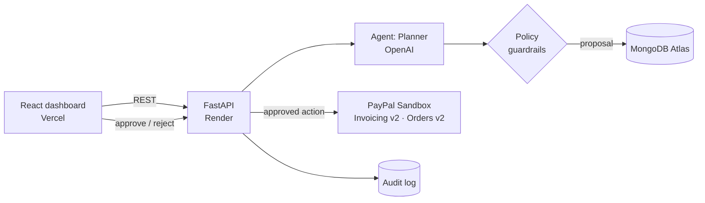

<div align="center">

# ✈️ FlowPilot AI

### An AI agent that chases overdue invoices for you, and never acts without your approval.

Built for the **PayPal AI Hackathon 2026** · Agentic AI × FinTech

[**Live Demo**](#) · [**Demo Video**](#) · [**Devpost**](#)


</div>

---

## 💸 The problem

Late payments are the quiet killer of small businesses and freelancers. Chasing an invoice means deciding *who* to nudge,
*how firmly*, and *whether to offer a payment plan*, then actually doing it. It's awkward, time-consuming, and usually postponed
until cash is already tight.

Fully automated dunning tools are blunt: the same email to your best client and your worst. And handing an LLM the keys to your
payments account is a non-starter.

## 🧭 The solution

**FlowPilot AI** is an agentic accounts-receivable assistant built on PayPal's APIs. For each overdue invoice it:

1. **Observes** the invoice, amount, days overdue, reminder count, and the client's payment history
2. **Plans** the right move with an LLM: friendly reminder, installment plan, escalate to the owner, or wait
3. **Checks policy:** hard-coded guardrails override the model (discount caps, contact-frequency limits, reminder limits)
4. **Asks you** to approve, with the full reasoning trace visible
5. **Acts** through PayPal: sends the invoice reminder or generates an installment payment link
6. **Logs** every decision to an append-only audit trail

> **Guarded autonomy:** the AI proposes, the policy decides what's allowed, the human decides what runs.

## ✨ Features

| | |
|---|---|
| 🧠 **Client-aware strategy** | Reliable payers get a gentle nudge; chronic late payers get a payment plan or escalation |
| 🛡️ **Policy guardrails** | Max 10% discount, max 4 installments, max 3 reminders, min 3 days between contacts, enforced in code, not in the prompt |
| 👤 **Human-in-the-loop** | Nothing touches PayPal until you click **Approve and run** |
| 🔍 **Transparent reasoning** | Every proposal shows its observe → plan → policy trace |
| 💳 **Real PayPal sandbox calls** | Invoices, reminders, and payment links are created through PayPal's actual REST APIs |
| 🧾 **Audit log** | Who did what, and when: agent, human, and PayPal events |
| 🪫 **Graceful fallback** | No OpenAI key or the API fails? A rule-based planner keeps the system working |

## 🏗️ Architecture



**Request flow:** `Ask agent` → LLM proposes → policy clamps or overrides → proposal saved as *pending* → human approves →
executor calls PayPal → result and audit entry saved.

## 🔌 How PayPal is used

| PayPal API | Endpoint | Purpose in FlowPilot |
|---|---|---|
| OAuth 2.0 | `POST /v1/oauth2/token` | Cached client-credentials token |
| Invoicing v2 | `POST /v2/invoicing/invoices` | Create invoices |
| Invoicing v2 | `POST /v2/invoicing/invoices/{id}/send` | Send to the client |
| Invoicing v2 | `GET /v2/invoicing/invoices/{id}` | Sync live payment status |
| Invoicing v2 | `POST /v2/invoicing/invoices/{id}/remind` | Send the approved reminder |
| Orders v2 | `POST /v2/checkout/orders` | Create a pay-now link for installment 1 |

## 🚀 Quick start

**Prerequisites:** Python 3.11+, Node 18+, a MongoDB URI (local or Atlas free tier), and a
[PayPal developer](https://developer.paypal.com) sandbox app.

```bash
# Backend
cd backend
python -m venv .venv && source .venv/bin/activate     # Windows: .venv\Scripts\activate
pip install -r requirements.txt
cp .env.example .env                                  # add your keys
uvicorn app.main:app --reload --port 8000

# Frontend (new terminal)
cd frontend
npm install && cp .env.example .env
npm run dev                                           # http://localhost:5173
```

**Verify PayPal first:**
```bash
curl localhost:8000/api/paypal/health       # {"ok": true, ...}
curl -X POST localhost:8000/api/seed        # creates 5 sandbox invoices
```

| Variable | Description |
|---|---|
| `PAYPAL_CLIENT_ID` / `PAYPAL_CLIENT_SECRET` | Sandbox app credentials |
| `DEMO_RECIPIENT_EMAIL` | A sandbox *personal* account email |
| `OPENAI_API_KEY` | Optional; falls back to rule-based planning |
| `MONGODB_URI` | MongoDB connection string |
| `FRONTEND_ORIGIN` | Allowed CORS origin (your Vercel URL in production) |

## ☁️ Deployment

- **API → Render:** New → Blueprint → select this repo (uses `render.yaml`), then add secrets.
- **Frontend → Vercel:** Root directory `frontend`, env `VITE_API_URL=https://<your-api>.onrender.com`.
- **Database → MongoDB Atlas:** free cluster, then paste the `mongodb+srv://` URI into Render.

## 🎬 Demo walkthrough (2 minutes)

1. Click **Create sandbox invoices**; five real invoices appear in the PayPal sandbox.
2. **Ask agent** on a reliable client (Lena): a friendly reminder is proposed.
3. **Ask agent** on a chronic late payer (Tom): the agent tries for more, and the **policy step trims or overrides it**.
4. **Approve** the reminder; PayPal sends it and the audit log records it.
5. **Approve** a payment plan; a live PayPal payment link is generated.

## 🏆 Why it fits the judging criteria

| Criterion | FlowPilot AI |
|---|---|
| **Technical implementation** | Async FastAPI, real PayPal Invoicing and Orders integration, LLM planner with deterministic policy layer and fallback |
| **Design** | A single-screen console: queue on the left, agent decisions and traces on the right |
| **Potential impact** | Late payments hit freelancers and SMBs everywhere; recovered cash is directly measurable |
| **Innovation** | Guarded autonomy: LLM judgment, code-enforced limits, human sign-off, full audit trail |
| **Presentation** | Visible reasoning trace and a clear before/after story |

## ⚠️ Honest limitations

- **Sandbox only.** No real money moves.
- **"Overdue" is simulated.** Sandbox invoices never actually become late, so days overdue, reminder counts, and client payment history are seeded demo data.
- **No authentication or multi-tenancy** in this version.
- Reminders go through PayPal's own reminder email; there is no separate email or SMS channel.

## 🗺️ Roadmap

- [ ] PayPal webhooks to update invoice status in real time
- [ ] Simulated client replies and agent negotiation within guardrails
- [ ] Cash-flow forecast from recovery probability
- [ ] Per-business policy editor
- [ ] Authentication and multi-tenant support

## 📁 Project structure

```
flowpilot-ai/
├── backend/app/    main · config · db · paypal · agent · routes
├── frontend/src/   App.jsx · api.js · styles.css
├── render.yaml
└── README.md
```

## 👤 Author

Built solo by **Amiul** ([@amiul0522](https://github.com/amiul0522)) for the PayPal AI Hackathon 2026.

---

<div align="center">
<sub>Sandbox project for a hackathon; not affiliated with or endorsed by PayPal.</sub>
</div>
